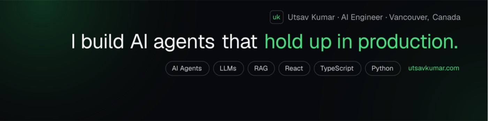

<div align="center">
  <a href="https://www.utsavkumar.com"></a>
</div>

<div align="center">


</div>

<p align="center">
AI Engineer in Vancouver, Canada with 10+ years of full-stack experience, building LLM agents, retrieval systems, voice AI and the infrastructure that makes them reliable for real users.
</p>

---

## 💫 About Me

I'm an **AI Engineer** with 10+ years of full-stack experience at **Highspot**, **Mercor** and **Splunk**. These days I build with AI at the core.

I work on the hard part of production AI: **latency, cost, context, grounding and reliability**, so people can trust what the model tells them.

At Highspot I helped ship the **Deal, Rep and Manager Agents**. They raised agent task success from **78% → 91%** across 500 eval cases, cut p95 time to first token from **8s → 0.8s**, and lowered AI compute cost by **~80%** with result caching.

> 🟢 **Open to work:** AI and agent engineering roles, full-time, part-time, contract or freelance.

### 🎯 Current Focus

- 🤖 **Agentic AI** - PydanticAI, LangGraph, tool calling, workflow routing, multi-agent orchestration
- 🔌 **MCP & Tool Use** - Model Context Protocol, typed tools, scoped tool exposure, agent integrations
- 🧠 **RAG & Grounding** - hybrid search, re-ranking, citation verification, refusing when it can't prove the answer
- 🎙️ **Voice AI** - streaming speech-to-text → orchestrator → speech with no awkward pauses
- 🛡️ **AI Reliability** - evals, rubrics, LLM-as-judge, guardrails, prompt-injection screening, human-in-the-loop
- ⚡ **Production AI** - SSE streaming, semantic caching, token and cost optimization, inference latency
- 🎯 **Model Training & Evaluation** - RLHF data, grading rubrics, reward modeling, reviewer calibration
- 💻 **AI Product Engineering** - Python/FastAPI backends with React/TypeScript/Next.js interfaces

---

## 🛠️ Core Stack

### 🤖 AI & Agents


### 🔎 Retrieval, Evaluation & LLMOps


### ⚙️ Engineering


---

## 🚀 Featured Projects

### 🧭 Astrolabe · AI World Clock

A world clock built as one rotating dial: eight cities on concentric rings, read straight down a single line. Turn time with your hand through the webcam, drop in a screenshot to jump to the times inside it, or ask for a meeting slot across cities in plain English.

- ✋ **On-device hand tracking:** pinch and circle to turn the dial, with no video leaving the browser
- 🖼️ **Vision-language model** reads times from screenshots, invites and text into exact time zones
- 📅 **Meeting finder** scores every 15-minute slot for a week against each city's working hours
- 🛡️ **Serverless API** with per-visitor and daily rate limits in Redis to protect a free model quota


[🌐 Live demo](https://astrolabe.utsavkumar.com) · [💻 Source code](https://github.com/utsavk1993/astrolabe)

### 🏭 Shipped in production

- 🤝 **Highspot Deal, Rep & Manager Agents:** conversational AI for sales teams on one shared agent platform. 150 weekly active reps and 12k workflows a month. [View project →](https://www.highspot.com/product/highspot-ai-agents/)
- 🎭 **Highspot AI Sales Coaching & Role-Play:** real-time coaching and practice conversations streamed over SSE. 2,000+ sessions a month. [View project →](https://www.highspot.com/product/ai-role-play/)
- 🧪 **Mercor AI Model Evaluation:** Expert Project Lead on 1,200+ evaluations of frontier-model output on software engineering tasks
- 📡 **Splunk Edge Processor & Data Stream Processor:** real-time UIs for shaping, routing and filtering machine data in flight

[Explore my work →](https://www.utsavkumar.com)

---

## 🧩 What I'm Building Around

```text
Agentic Systems         ████████████████████
RAG & Grounding         ███████████████████
MCP & Tool Use          ██████████████████
Evals & Reliability     ██████████████████
Voice AI                █████████████████
Latency & Cost          █████████████████
AI Product Engineering  ████████████████████
```

My focus is increasingly on the engineering around the model: **orchestration → retrieval → tools → grounding → evaluation → observability → deployment**

Getting an LLM to answer once is easy. Getting the whole system to answer fast, cheaply and correctly for thousands of real users is the real engineering problem.

---

## 💼 Experience

| | Company | Role | When |
| :-: | :--- | :--- | :--- |
| 📈 | **[Highspot](https://www.highspot.com)** | Senior Software Development Engineer, AI Agents | 2023 – 2026 |
| 🧠 | **[Mercor](https://www.mercor.com)** | Software Engineering Expert · Expert Project Lead | 2025 – 2026 |
| 🔎 | **[Splunk](https://www.splunk.com)** | Software Engineer, Edge Processor & Data Stream Processor | 2018 – 2023 |
| ⚙️ | **[Cybage](https://www.cybage.com)** | Software Engineer, Turn Campaign Suite | 2015 – 2017 |

---

## 📊 GitHub Activity

<div align="center">


<br/>


</div>

---

## 🌐 Connect

<div align="center">

<a href="https://www.utsavkumar.com/">
  
</a>

<a href="https://www.linkedin.com/in/utsavk1993/">
  
</a>

<a href="mailto:utsavkumar.ca@gmail.com">
  
</a>

</div>

<br>

<div align="center">

### Open to AI engineering roles, contract work and open-source collaboration

</div>

<div align="center">
  
</div>

<div align="center">
  <sub>Updated November 2026</sub>
</div>
